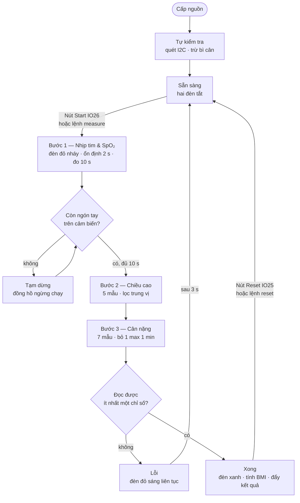
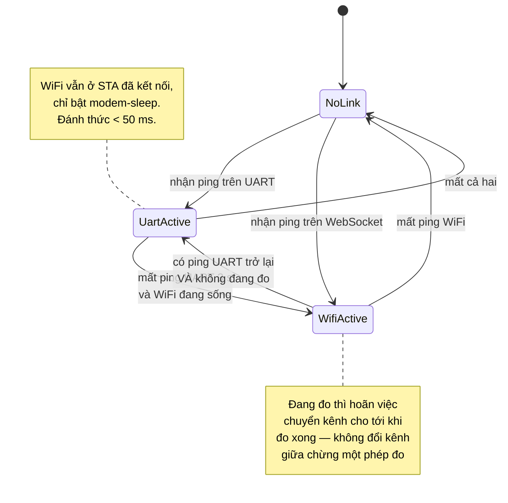
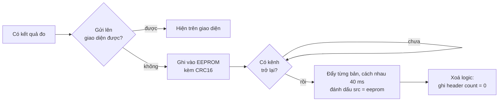

# Lưu đồ thuật toán

Yêu cầu dự án nêu rõ: *"giảm lưu đồ thuật toán so với lưu đồ của dự án mẫu"*.

Dự án mẫu vẽ mỗi khối chức năng một lưu đồ riêng vì toàn bộ logic nằm trong một hàm `main()`
485 dòng. Bản này chỉ cần **ba lưu đồ**, tương ứng với ba nhóm công việc trong
[`SATx.ino`](../firmware/SATx/SATx.ino):

1. **Chu trình đo** — máy trạng thái tuần tự
2. **Quản lý kết nối** — ưu tiên UART, dự phòng WiFi
3. **Bộ đệm EEPROM** — chỉ dùng khi mất kết nối hoàn toàn

Mã nguồn dùng các hàm thông thường trong một file. Đọc `setup()` để xem thứ tự khởi tạo,
rồi đọc `loop()` để theo dõi nút nhấn, chu trình đo, kết nối và bộ đệm. Sau đó tìm phần
đọc cảm biến hoặc xử lý bản tin cần tìm hiểu. Việc gom file giữ nguyên ba luồng xử lý này.

## 1. Chu trình đo

**Khác với dự án mẫu:** bản PIC tự viết bộ dò đỉnh AC/DC rồi đoán độ tin cậy qua điều kiện
`sample_count > 200`. Bản này dùng thuật toán tham chiếu của Maxim trong thư viện SparkFun
MAX3010x, vốn trả kèm cờ `validHeartRate` / `validSPO2`. Nhờ vậy nhánh "kết quả có đáng tin
không" biến mất khỏi lưu đồ — thư viện đã trả lời sẵn.

Một chỉ số hỏng **không** làm hỏng cả phép đo: các chỉ số còn lại vẫn được ghi nhận, chỉ trường
hỏng bị đánh dấu không hợp lệ và gửi lên dưới dạng `null`.

## 2. Quản lý kết nối

## 3. Bộ đệm EEPROM

Nhịp 40 ms giữa hai bản ghi là có chủ đích: đẩy liên tục sẽ làm nghẽn kênh truyền và làm trễ
chu trình đo nếu người dùng bấm đo ngay lúc đó.

Bản ghi hỏng CRC bị bỏ qua và **không** làm dừng cả lượt đẩy — nếu không, một byte hỏng sẽ
khoá vĩnh viễn toàn bộ dữ liệu phía sau.

## Bảng đối chiếu số lưu đồ

| | Dự án mẫu | Bản này |
|---|---|---|
| Lưu đồ tổng | 1 | 1 (chu trình đo) |
| Đọc từng cảm biến | 3 lưu đồ riêng | 0 — gộp thành 3 bước trong lưu đồ tổng |
| Quét bàn phím | 1 | 0 — thay bằng nút nhấn chống dội, không cần lưu đồ |
| Xử lý UART | 1 | 1 (quản lý kết nối, gộp cả WiFi) |
| Xử lý nhịp tim/SpO₂ | 1 | 0 — thư viện đảm nhiệm |
| Lưu trữ | không có | 1 (bộ đệm EEPROM) |
| **Tổng** | **7** | **3** |
