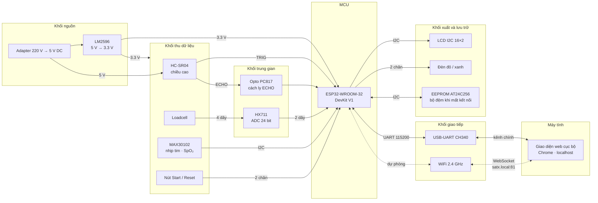

# Sơ đồ khối hệ thống

Bản cập nhật của `Mục yêu cầu SATx/Bản sao của Sơ đồ khối`, phản ánh những thay đổi của đợt
nâng cấp: đổi MCU sang ESP32, bỏ bàn phím ma trận, thêm EEPROM, và chuyển giao diện lên web.

## Khác với sơ đồ gốc

| Khối | Dự án mẫu | Bản này | Lý do |
|---|---|---|---|
| MCU | PIC16F877A | ESP32-WROOM-32 | Có sẵn WiFi, đủ RAM cho thuật toán SpO₂ tham chiếu |
| Nhập liệu | Bàn phím ma trận 4×4 | Hai nút Start / Reset | Mọi thao tác khác đã chuyển lên giao diện web |
| Lưu trữ | không có | EEPROM AT24C256 | Giữ kết quả khi mất kết nối hoàn toàn |
| Giao diện | WinForm C# | Web cục bộ trong Chrome | Không cần cài đặt, chạy được trên mọi máy |
| Kênh truyền | chỉ UART | UART chính + WiFi dự phòng | Yêu cầu dự án |

Ba đường nét đứt trong sơ đồ là **đường dự phòng**: WiFi chỉ nhận việc khi UART mất tín hiệu
quá 3 giây. Xem [giao-thuc.md](giao-thuc.md), mục *Chuyển kênh UART ↔ WiFi*.
